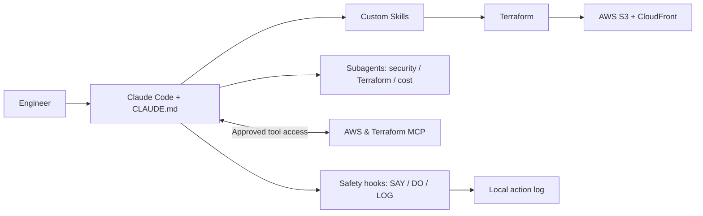
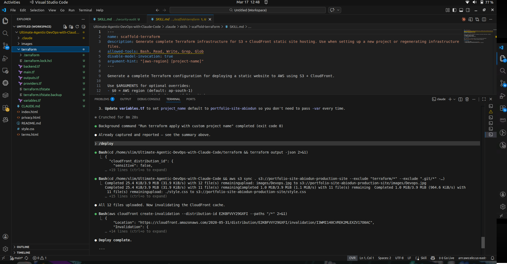
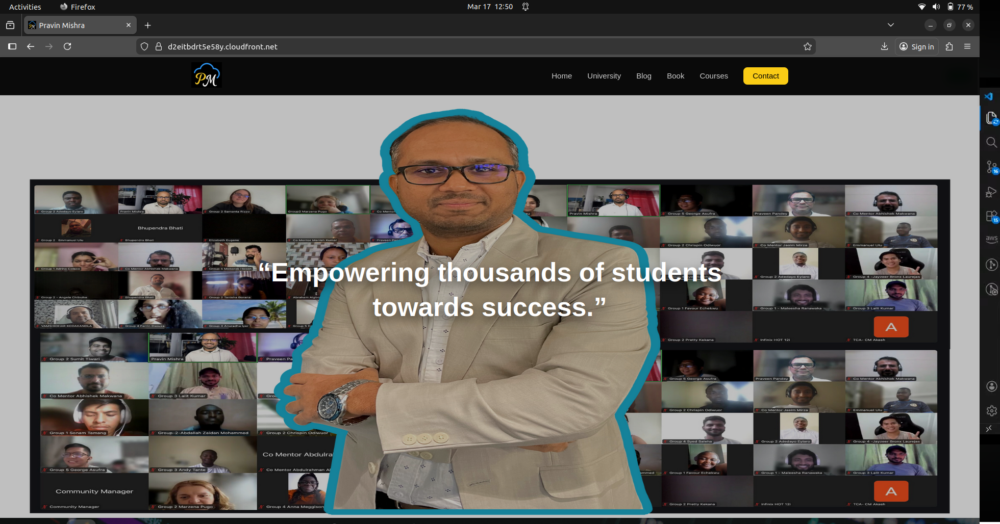
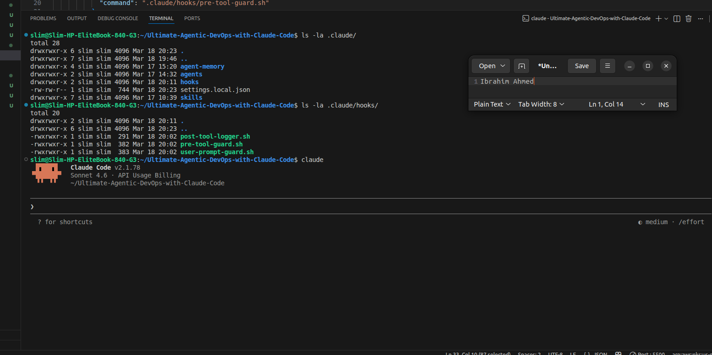

# Agentic AI DevOps with Claude Code

**Claude Code · AWS · Terraform · S3 · CloudFront · Skills · Subagents · MCP · Safety Hooks**  
**DevOps Micro Internship (DMI), Cohort 2 — Week 9**

An AI-assisted DevOps portfolio project demonstrating how I configured Claude Code for infrastructure workflows, deployed a **static HTML/CSS portfolio website** on AWS using Terraform, reviewed security and cost recommendations with specialist agents, integrated external tools through MCP, and tested automation safety hooks.

> **Scope:** This repository builds on training materials from the *Ultimate Agentic AI DevOps with Claude Code* course. My documented contributions concern project configuration, the AWS/Terraform workflow, testing, troubleshooting, evaluation of agent findings, and documentation. Screenshots are historical evidence from my Week 9 report; they do **not** establish currently running AWS resources or production readiness.

## Architecture



[Detailed editable diagram](diagrams/architecture.mmd)

## Project documentation — seven guides

| Section | Focus | Evidence |
|---|---|---|
| [01 — Claude Code setup](docs/01-CLAUDE-CODE-SETUP.md) | Linux CLI installation, prerequisites, account/API authentication | CLI screenshot |
| [02 — CLAUDE.md configuration](docs/02-CLAUDE-MD-CONFIGURATION.md) | Project context, architecture, conventions, prompt verification | Instruction screenshots |
| [03 — Custom DevOps Skills](docs/03-CUSTOM-DEVOPS-SKILLS.md) | `SKILL.md`, Terraform scaffold/plan/apply, deploy, security audit | Skills screenshot |
| [04 — Skills in action / deployment](docs/04-TERRAFORM-AUTOMATED-DEPLOYMENT.md) | Terraform → S3 → CloudFront; failures and validation | Terraform and website screenshots |
| [05 — AI Subagents](docs/05-AI-SUBAGENTS.md) | Security Auditor, Terraform Writer, Cost Optimizer | Agent reports |
| [06 — MCP server integration](docs/06-MCP-SERVER-INTEGRATION.md) | Terraform/AWS MCP, connected tools, audit/fix/verify | MCP screenshots |
| [07 — Safety hooks & permissions](docs/07-SAFETY-HOOKS-AND-PERMISSIONS.md) | Prompt guard, pre-tool guard, post-tool logging | Hook execution screenshots |

## Outcomes documented

- Followed a **scaffold → plan → apply → deploy** Terraform workflow and deployed a static portfolio using **Amazon S3 and CloudFront**.
- Addressed missing AWS IAM permissions and an S3 bucket-name conflict during the lab.
- Used a security-assisted review to address **KMS findings F-02 and F-03**, followed by `terraform validate` and a subsequent review; not every finding was resolved.
- Reviewed a cost agent's estimate of **$15.01/month → $6.24/month** after recommended optimizations. This was an **estimate**, not a verified reduction in an AWS invoice.
- Tested hooks that guarded prompts, blocked selected destructive commands, and logged a permitted Claude-driven infrastructure action.

## Evidence gallery

The images below were extracted from the **original Week 9 Word document**. Click to open at original resolution.

| Terraform planning | Website deployed |
|:--:|:--:|
| [](screenshots/06-terraform-plan.png) | [](screenshots/08-deployed-portfolio.png) |

| Subagent security review | Safety hooks |
|:--:|:--:|
| [](screenshots/10-security-audit.png) | [](screenshots/16-hook-execution.png) |

[View all 19 original screenshots and their captions](screenshots/README.md).

## Project layout

```text
Ultimate-Agentic-DevOps-with-Claude-Code/
├── CLAUDE.md
├── .claude/
│   ├── skills/                  # scaffold-terraform, tf-plan, tf-apply, deploy, security-audit
│   ├── agents/                  # security-auditor, tf-writer, cost-optimizer
│   └── hooks/                   # user-prompt, pre-tool, post-tool
├── terraform/                  # .tf configuration files
├── index.html, style.css, images/
├── README.md
├── docs/                       # the seven technical guides + safety checklists
├── screenshots/                # Week 9 Word evidence
└── diagrams/architecture.mmd
```

The documentation ZIP provides only the files under `README.md`, `docs/`, `screenshots/`, and `diagrams/`; **your existing source, Skills, agents, hooks, and Terraform files are not replaced**.

## Skills demonstrated

**Infrastructure:** Terraform, AWS S3, CloudFront, IAM troubleshooting, Infrastructure as Code.  
**Agentic workflows:** Claude Code, `CLAUDE.md`, custom Skills, specialist subagents, MCP.  
**Operational safety:** human review, IaC validation, permission controls, security assessment, cost review, hook logging.  
**Engineering:** Linux, VS Code, Git/GitHub, documentation, deployment debugging.

## Security and publication

**Do not commit** `terraform.tfstate`, `.terraform/`, secrets, private keys, `deploy.log`, or local credential-bearing configurations. Review `.mcp.json` and `.claude/settings.local.json` before deciding whether to publish sanitized examples. [Security guidance](docs/SECURITY.md) · [Publishing checklist](docs/GITHUB_PUBLISHING.md) · [`.gitignore` suggestions](docs/GITIGNORE_RECOMMENDATIONS.md) · [Troubleshooting](docs/TROUBLESHOOTING.md).

## Attribution

**Original course, template, and supplied examples:** *Ultimate Agentic AI DevOps with Claude Code* / Pravin Mishra's DMI training resources.  
**Infrastructure lab execution, configuration, security/cost reviews, troubleshooting, and portfolio documentation:** [@slim274](https://github.com/slim274).
