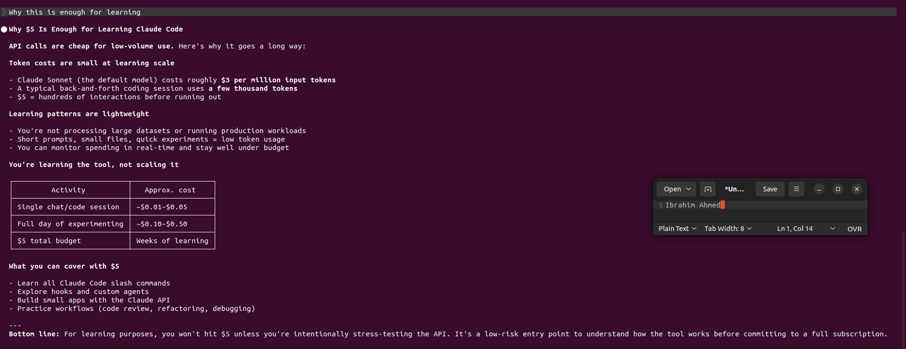

# 01 — Claude Code setup and development environment

[← Project README](../README.md) · [Next: CLAUDE.md →](02-CLAUDE-MD-CONFIGURATION.md)

**Week 9, Assignment 1.** This guide describes the development environment and Claude Code CLI setup documented in my internship report.

## Goal

Prepare a Linux development environment for AI-assisted DevOps work: Claude Code, AWS CLI, Terraform, Docker, Python/`uvx`, VS Code, and a GitHub project checkout.

## Reported implementation

- Checked the available versions of key command-line tools (including AWS CLI, Terraform, Docker, and `uvx`) before using the project.
- Created an Anthropic/Claude Platform account; the assignment records using a **$5 API credit** method.
- Installed Claude Code globally during the exercise using `sudo npm install -g @anthropic-ai/claude-code` after a non-root install returned an `EACCES` permission error.
- Set `ANTHROPIC_API_KEY` in the shell environment rather than writing its value into source code and ran a basic prompt to confirm that the CLI responded.
- Forked and cloned the course repository into my GitHub workspace: [`slim274/Ultimate-Agentic-DevOps-with-Claude-Code`](https://github.com/slim274/Ultimate-Agentic-DevOps-with-Claude-Code). This is a training-derived fork, not a newly authored application.

## Setup and verification commands (safe reference)

```bash
aws --version
terraform version
docker --version
command -v uvx
node --version
claude --version
```

The report uses the following form for authentication (placeholder only):

```bash
export ANTHROPIC_API_KEY="<set-your-key-locally>"
claude "Explain the DevOps lifecycle in 5 steps."
```

**Do not commit the actual API key** into a shell script, screenshot, README, or Git repository. Prefer a user-managed Node/npm installation over globally changing directories with `sudo` when preparing a new environment.

## Troubleshooting and learning

| Experience | Reported response |
|---|---|
| Global npm install returned `EACCES` | Used elevated privileges for the training environment. |
| Attempted a Windows-style `setx` command | Switched to Linux's `export` syntax. |
| Terraform indicated an available upgrade | Confirmed the installed version worked and proceeded. |

**Learning:** Environment verification and correctly scoped credentials are prerequisites for reliable automation; a responsive Claude Code CLI is not yet proof of cloud permissions.

## Screenshots

[](../screenshots/01-claude-code-cli.png)

Source: original Week 9 Word report, **Assignment 1**. [Evidence index](../screenshots/README.md).
