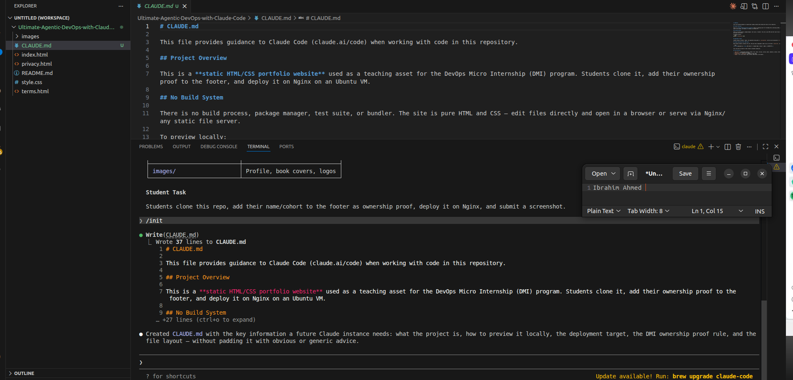
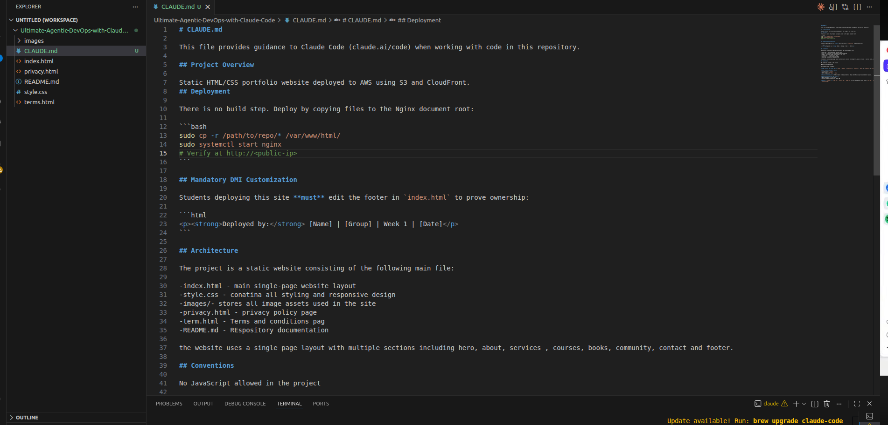

# 02 — Teaching Claude the project with `CLAUDE.md`

[← Project README](../README.md) · [← Setup](01-CLAUDE-CODE-SETUP.md) · [Next: Custom Skills →](03-CUSTOM-DEVOPS-SKILLS.md)

**Week 9, Assignment 2.** `CLAUDE.md` provides persistent repository guidance; it is distinct from a `SKILL.md` file, which gives instructions for a specific workflow.

## Goal and implementation

The course project is a **static HTML/CSS portfolio website**, with files including `index.html`, `style.css`, `privacy.html`, `terms.html`, and `images/`. The report describes:

1. Opening Claude Code in the project directory and running `/init` to generate an initial `CLAUDE.md`.
2. Reviewing and refining the generated description, file locations, project structure, and deployment guidance rather than accepting all text uncritically.
3. Writing clear conventions around static assets, responsive CSS, and avoiding unnecessary frameworks.
4. Testing project understanding with prompts such as `What is this project?` and `Add a React component to the homepage`.

The recorded test showed that Claude identified the static project and questioned a React component addition because it conflicted with the written **no-JavaScript/no-framework** conventions.

## What the project instructions cover

| Section | Purpose |
|---|---|
| Project overview | Defines a static portfolio and its intended audience. |
| Repository layout | Lists the HTML, CSS, and image files to edit. |
| Editing conventions | Establishes style, asset naming, and framework boundaries. |
| Deployment context | Describes relevant deployment targets and processes. |
| Safety / verification | Reminds the agent to check changes and seek approval for high-impact actions. |

**Deployment-context note:** The report references different deployment contexts while refining `CLAUDE.md` (Ubuntu/Nginx in the initial output and AWS S3/CloudFront in later revisions). These are stages of the documentation exercise; the actual Week 9 automated static-hosting lab uses **S3 and CloudFront**.

## Result and limits

Documented project constraints improved the relevance of agent responses. However, written agent instructions **do not enforce cloud permissions**; IAM, tool authorization, code review, and security checks remain necessary.

## Screenshots

| Initial instructions | Refined conventions |
|:--:|:--:|
|  |  |

Source: original Week 9 Word report, **Assignment 2**. [Evidence index](../screenshots/README.md).
