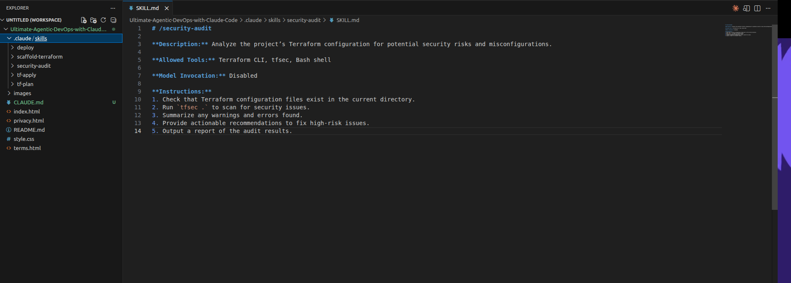

# 03 — Custom DevOps Skills (`SKILL.md`)

[← Project README](../README.md) · [← CLAUDE.md](02-CLAUDE-MD-CONFIGURATION.md) · [Next: Deployment →](04-TERRAFORM-AUTOMATED-DEPLOYMENT.md)

**Week 9, Assignment 3.** A Skill is a reusable, task-focused instruction bundle; `CLAUDE.md` is the longer-lived project context.

## Skills created or arranged for the lab

The report and project folder show five skill directories under `.claude/skills/`:

| Skill directory | Intended task |
|---|---|
| `scaffold-terraform/` | Create or update starter Terraform configuration based on a specification. |
| `tf-plan/` | Inspect proposed infrastructure changes before applying them. |
| `tf-apply/` | Apply **reviewed and approved** infrastructure changes. |
| `deploy/` | Upload the static site to Amazon S3 and invalidate CloudFront cache as needed. |
| `security-audit/` | Inspect infrastructure code and configuration for security weaknesses. |

Each directory holds a `SKILL.md` with task instructions. The report describes organizing course-provided examples into the expected directory structure, then exploring a security-audit skill format and its allowed tools.

```text
.claude/skills/
├── scaffold-terraform/SKILL.md
├── tf-plan/SKILL.md
├── tf-apply/SKILL.md
├── deploy/SKILL.md
└── security-audit/SKILL.md
```

These are **paths to the existing local implementation**; the documentation ZIP does not manufacture or overwrite Skill source files.

## Workflow principles

- A Skill should have a clear **purpose and input**, expected steps, allowed tool usage, and a checkable outcome.
- Separate **read-only review** (`tf-plan`, security audit) from **state-changing operations** (`tf-apply`, deployment).
- Do not assume an AI-generated plan is correct; inspect the actual Terraform plan, resource names, estimated cost, and AWS account.
- For reusable projects, apply only after a human confirms the intended changes.

## What I learned

Skill directories make repeated DevOps operations easier to invoke consistently. They remain guidance to the assistant, not a substitute for IAM boundaries or deployment approvals.

## Screenshot

[](../screenshots/04-custom-devops-skills.png)

Source: original Week 9 Word report, **Assignment 3**. [Evidence index](../screenshots/README.md).
