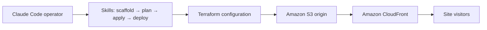
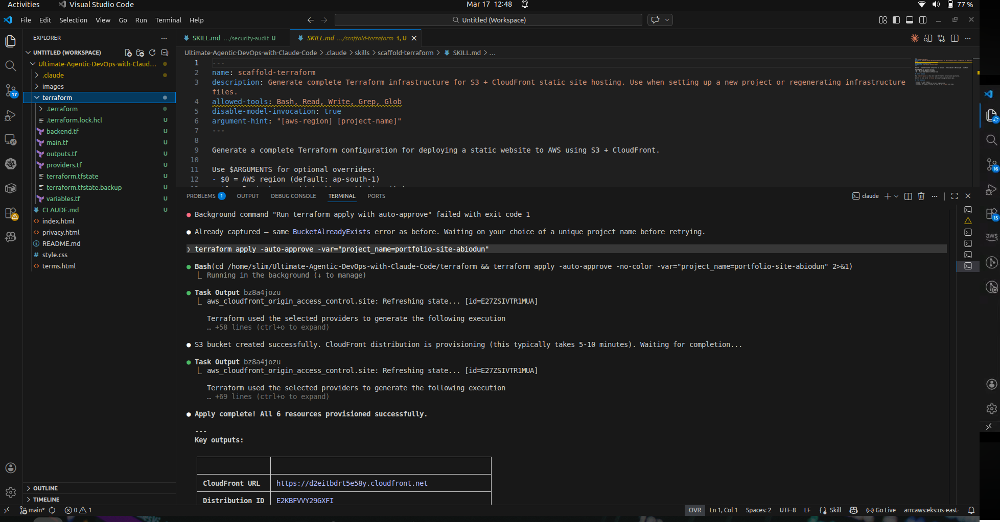
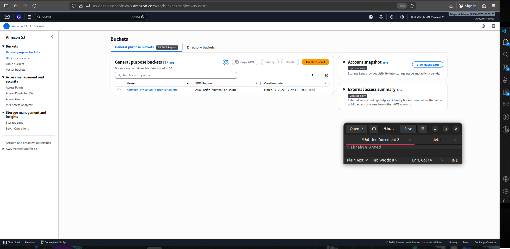

# 04 — Skills in action: Terraform, Amazon S3 and CloudFront

[← Project README](../README.md) · [← Skills](03-CUSTOM-DEVOPS-SKILLS.md) · [Next: Subagents →](05-AI-SUBAGENTS.md)

**Week 9, Assignment 4.** The deployment target was a **static HTML/CSS portfolio**. This exercise is not a Docker, EC2, or Kubernetes application deployment.

## Architecture and goal



The workflow prepares AWS resources with Terraform and publishes site assets through S3 with CloudFront distribution and cache invalidation.

## What the report documents

1. Placed skill files such as `scaffold-terraform`, `tf-plan`, `tf-apply`, and `deploy` in `.claude/skills/`.
2. Used a Terraform scaffolding Skill to create infrastructure configuration and a plan step to inspect intended changes.
3. Attempted Terraform apply and worked through AWS permission problems; the lab describes granting temporary IAM access for required S3 and CloudFront operations.
4. Resolved a global **S3 `BucketAlreadyExists`** naming conflict by selecting a unique name.
5. Applied infrastructure changes and used `/deploy` to synchronize website assets to S3 and trigger CloudFront invalidation.
6. Checked AWS resources and a browser view of the published portfolio.

The report includes an `-auto-approve` Terraform example. **Do not run it unchanged in a general-purpose project.** Prefer reviewed plans and explicit confirmation for cloud changes.

## Checks before reproducing

```bash
cd terraform
terraform fmt -check
terraform validate
terraform plan
```

These are reference checks, not a guarantee that the current local state or AWS environment is safe. Confirm credentials, target AWS account, remote state configuration, naming uniqueness, and costs before execution. Protect `terraform.tfstate` and `terraform/.terraform/` from Git.

## Results and limitations

The report records a completed S3/CloudFront portfolio deployment workflow and illustrates its result. The screenshots do not prove that the cloud resources are still live, that the infrastructure is highly available in every failure scenario, or that production hardening has been performed.

## Screenshots

| Terraform scaffold | Terraform plan |
|:--:|:--:|
| [](../screenshots/05-scaffold-terraform.png) | [](../screenshots/06-terraform-plan.png) |

| AWS S3 resources | Deployed portfolio |
|:--:|:--:|
| [](../screenshots/07-aws-s3-resources.png) | [](../screenshots/08-deployed-portfolio.png) |

Source: original Week 9 Word report, **Assignment 4**. [Evidence index](../screenshots/README.md).
