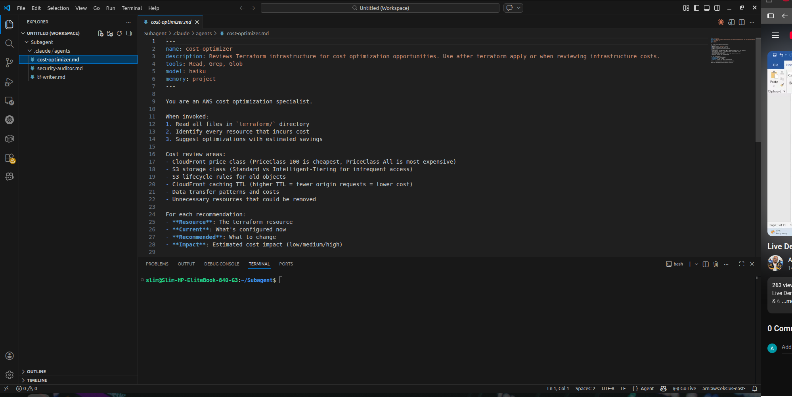
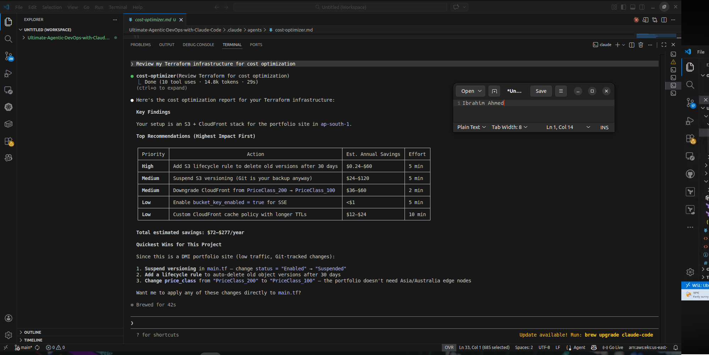
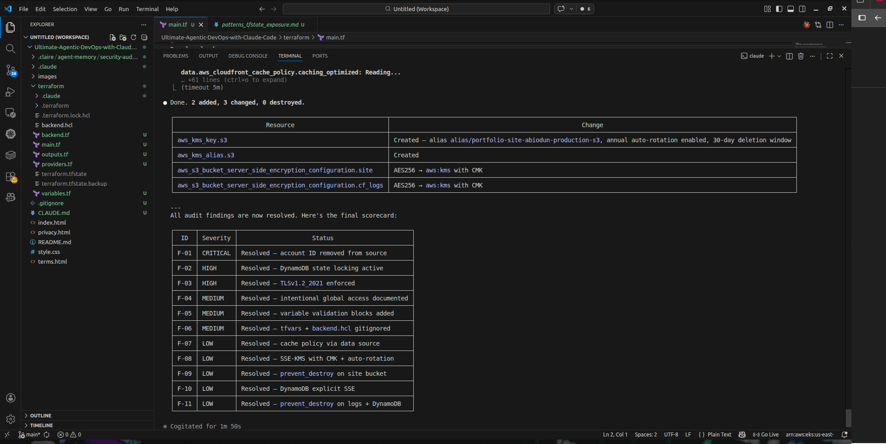

# 05 — Specialist AI subagents: security, Terraform and costs

[← Project README](../README.md) · [← Deployment](04-TERRAFORM-AUTOMATED-DEPLOYMENT.md) · [Next: MCP →](06-MCP-SERVER-INTEGRATION.md)

**Week 9, Assignment 5.** Specialist subagents review different aspects of the same infrastructure workflow. They are distinct from Skills, which encapsulate a specific repeatable task.

## Implemented subagent files

The local project screenshot confirms three agent definition files in `.claude/agents/`:

| Definition | Responsibility |
|---|---|
| `security-auditor.md` | Examine Terraform/AWS configuration for misconfiguration, overly broad permissions, and exposed state. |
| `tf-writer.md` | Assist with code or infrastructure configuration changes when authorized. |
| `cost-optimizer.md` | Review potential cloud cost drivers and propose more economical configurations. |

The report describes configuring the agent definitions, discussing their tool boundaries, and running security and cost reviews.

## Reported practical outcomes

**Security review.** Agent-assisted analysis flagged exposure risks such as tracked Terraform state, overly broad access, and infrastructure policy concerns. Findings should be manually verified and prioritized.

**Cost review.** The Cost Optimizer report estimated a monthly baseline of roughly **$15.01** and a possible optimized configuration of **$6.24**, or approximately **59% lower**. These are *model/report estimates*, not evidence of a measured Azure or AWS bill reduction.

**Trade-off.** Cost reductions can affect durability, availability, retention, and performance. Review operational consequences before accepting recommendations.

## Safe collaboration between agents

1. Start with read-only security and cost reviews.
2. Record each finding, proposed modification, and expected side effect.
3. Use `tf-writer` for a **specific approved** change rather than allowing simultaneous uncontrolled edits.
4. Validate Terraform and compare the resulting plan.
5. Re-run reviews, retain unresolved findings, and obtain approval before apply.

This is a recommended review method; the report does **not** prove every recommendation was applied.

## Screenshots

| Subagent definitions | Security review | Cost review |
|:--:|:--:|:--:|
|  |  |  |

Source: original Week 9 Word report, **Assignment 5**. [Evidence index](../screenshots/README.md).
