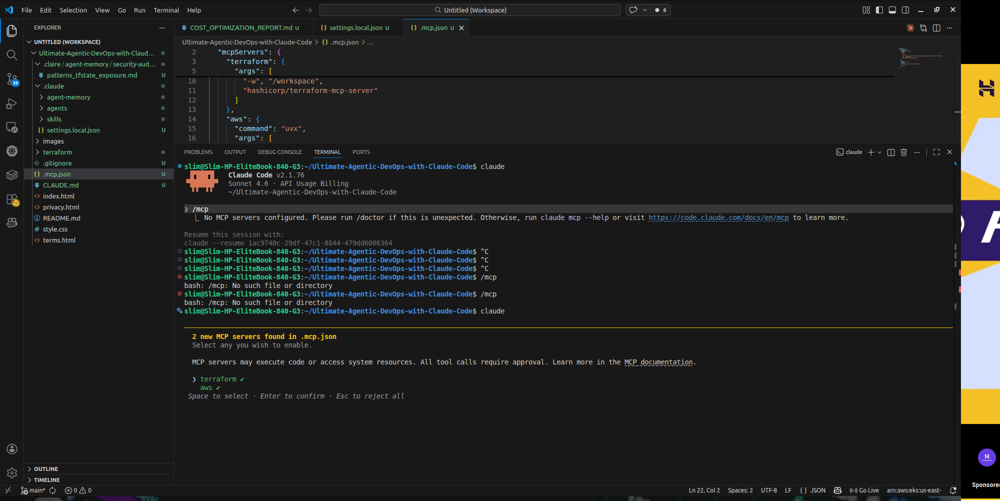
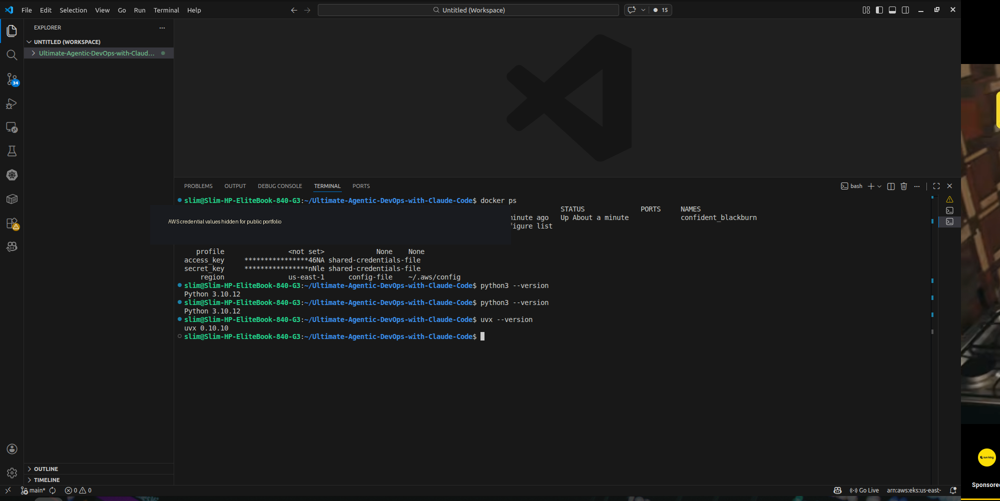
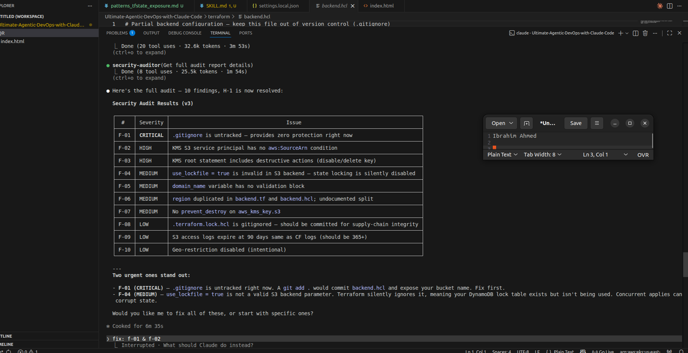

# 06 — MCP integration: Terraform and AWS tools

[← Project README](../README.md) · [← Subagents](05-AI-SUBAGENTS.md) · [Next: Safety hooks →](07-SAFETY-HOOKS-AND-PERMISSIONS.md)

**Week 9, Assignment 6.** The Model Context Protocol (MCP) enables an AI client to connect to permitted external tool capabilities. It does not bypass AWS IAM, and connectivity alone does not establish safe execution.

## Reported setup

- Prepared a project-root `.mcp.json` describing Terraform and AWS MCP servers.
- Checked prerequisites including Claude Code, Docker, AWS CLI and relevant command-line tools.
- Initially encountered **`No MCP servers configured`**. The report describes correcting the `.mcp.json` location, reviewing a local Docker workspace mount path, and restarting Claude Code.
- Opened MCP tool discovery/status and enabled the available Terraform and AWS integrations for the exercise.

> **Do not publish your working `.mcp.json` without review.** It can contain local filesystem paths, token variables, account-specific configuration, or other secrets. Publish a sanitized example separately only after checking its contents.

## Review → fix → verify

The report describes using connected tools and agents to revisit selected **AWS KMS policy findings**:

| Finding | Reported change |
|---|---|
| **F-02 — Confused deputy** | Constrained use of KMS permissions for S3 through an `aws:SourceAccount` condition. |
| **F-03 — Destructive KMS actions** | Added MFA-related conditions to guard destructive key-management operations. |

After changes, the report records a `terraform validate` check and a follow-up security review. It does **not** establish that every finding was fixed; **F-01**, involving source-control/state safeguards, was noted for follow-up.

## Security considerations

- Use least-privilege AWS IAM policies and restricted tool permissions.
- Show the proposed action and its effects to a human before mutating Terraform or cloud resources.
- Do not assume audit findings are correct without examining Terraform code and AWS semantics.
- Rotate any credential that may have appeared in shell history, repository files, or screenshots.

## Screenshots

| MCP tool discovery | Prerequisite checks | Security follow-up |
|:--:|:--:|:--:|
|  |  |  |

**Privacy:** The prerequisite screenshot had credential-status rows redacted in the previous documentation package. Confirm the images are still suitable before public posting.

Source: original Week 9 Word report, **Assignment 6**. [Evidence index](../screenshots/README.md).
